# Lost & Found

**Comic identity / Issue 01** · Three-page static website and interactive design-system reference.

> **Artwork policy:** No AI-generated art, emblem, logo, illustration, character, or mark is included. The primary mark is reserved for human-created artwork.

## Pages

| Document | Purpose |
| --- | --- |
| [Homepage](https://kadench.github.io/fantastic_lost_and_found/index.html) | Comic-cover hero, story, features, and interactive clue dialogue |
| [Style guide](https://kadench.github.io/fantastic_lost_and_found/styleguide.html) | Reference specimens for color, typography, controls, full form, states, and spacing |
| [404](https://kadench.github.io/fantastic_lost_and_found/404.html) | Animated portal with interactive clue dialogue and return link |

## Palette

| Color | Hex | Preview |
| --- | --- | --- |
| Midnight ink | `#101426` |  |
| Panel navy | `#191F35` |  |
| Paper white | `#FFF8EC` |  |
| Power yellow | `#FFCF33` |  |
| Action red | `#FF4B54` |  |
| Electric blue | `#315BFF` |  |
| Text red on light | `#A81736` |  |
| Text blue on light | `#123B9B` |  |

The swatch assets above are plain, manually specified rectangles—not illustrations. Approved text pairings are documented in [the style guide](styleguide.html#colors). Bright red and blue are graphic accents, not general-purpose body-text foregrounds.

## Typography

| Role | Family | Weight |
| --- | --- | --- |
| Display and H1–H6 | Archivo Black | 900 |
| Body / controls | DM Sans | 400–800 |

Sizes, line heights, button states, input types, and layout tokens are shown in the [interactive specimens](styleguide.html). Fonts load from Google Fonts with local sans-serif fallbacks.

## Source layout

```text
index.html
styleguide.html
404.html
css/
  tokens.css
  base.css
  components.css
  homepage.css
  styleguide.css
  404.css
js/
  main.js
  styleguide.js
  404.js
assets/
  swatches/
  human-artwork/
.prettierrc.json
README.md
```

Styles are authored with 2-space indentation, shared design tokens, semantic HTML, and small ES modules. No build process or JavaScript framework is required. All interactions run locally. The specimen form does not transmit information.

## Accessibility contract

- Target WCAG 2.2 **AAA text contrast** for approved foreground/background combinations; non-text affordances target at least 3:1 where applicable.
- Content and controls use semantic HTML, visible focus, explicit labels, and text feedback rather than relying on color alone.
- Native inputs support keyboard and assistive technology interaction.
- Reduced-motion preference disables nonessential animation.
- Responsive CSS is designed for narrow screens, text reflow, and mobile navigation.
- **Conformance is not certified.** Full browser, zoom, screen-reader, color-vision, and manual QA remain required.

## Reference standards

- [W3C WCAG 2.2](https://www.w3.org/TR/WCAG22/)
- [U.S. Web Design System — in-page navigation](https://designsystem.digital.gov/components/in-page-navigation/)
- [GOV.UK Design System — components](https://design-system.service.gov.uk/components/)
